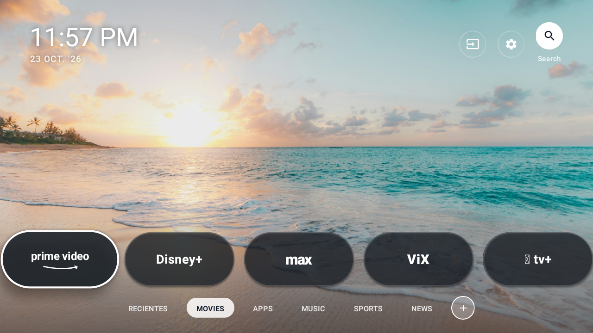

<div align="center">

# 📺 TCL Ambient Glass Smart Launcher & PWA Remote
### Launcher Minimalista de Cristal Ahumado, Sin Publicidad, con Auto-Salto de Perfiles Streaming y Control Remoto Web para Android TV / Google TV

[](https://kotlinlang.org/)
[](https://developer.android.com/jetpack/compose/tv)
[](https://www.android.com/tv/)
[](http://localhost:8888)
[](LICENSE)
[](.github/workflows/android-build.yml)

<br/>

**Transforma tu Smart TV TCL en una experiencia visual premium, fluida y personal.**  
*0% Bloatware · 0% Publicidad · 100% Reversible · Sin Root ni riesgo para tu televisor.*

<br/>



</div>

---

## 💡 ¿Por qué nació este proyecto?

Los Smart TVs modernos (especialmente los televisores **TCL con Android TV / Google TV**) sufren de un problema común: su interfaz de inicio de fábrica viene saturada de **publicidad forzada, recomendaciones patrocinadas, banners gigantes y procesos en segundo plano** que consumen memoria RAM y CPU, volviendo la navegación lenta y frustrante.

Las alternativas habituales suelen ser launchers toscos con apariencia de los años 2010, o scripts agresivos que requieren acceso *root* o desinstalan paquetes del sistema mediante comandos peligrosos (`pm uninstall`), lo que puede anular garantías o romper funciones del televisor.

**TCL Smart Launcher** fue diseñado desde cero para resolver este problema:
- ✅ **75% de pantalla despejada:** disfruta de fotografía en alta resolución o tus propias fotos familiares en lugar de publicidad comercial.
- ✅ **Rendimiento instantáneo:** desarrollado en Kotlin puro con Jetpack Compose for TV, ligero como una pluma.
- ✅ **Cero Root y 100% Reversible:** utiliza las APIs estándar de Android (Servicio de Accesibilidad) para interceptar el botón Home 🏠 sin modificar ninguna partición de la TV. Puedes volver al launcher original con 1 solo clic.
- ✅ **Control Remoto Móvil Integrado (PWA en `:8888`):** controla el televisor desde cualquier teléfono celular abriendo un enlace web o escaneando un código QR, **sin instalar ninguna aplicación en el móvil**.

---

## ✨ Características Principales

### 🖼️ 1. Diseño "Ambient Glass Wallpaper" (Frosted Glass)
* **75% de la pantalla libre:** interfaz limpia que deja respirar a la pantalla, ideal para fotografía 4K, fondos artísticos o fotos personales.
* **Cápsulas en Cristal Ahumado (*Frosted Glass*):** tarjetas translúcidas con desenfoque suave, bordes luminosos y logotipos vectoriales de alta definición.
* **Navegación Fluida con D-Pad:** animaciones suaves de escala (1.08x) y resplandor zafiro (`#2563EB`) optimizadas para el control remoto físico de la TV.
* **Reloj y Fecha Minimalista:** indicador de hora en vivo en la esquina superior sin estorbar la visualización.

### ⏮️ 2. Historial Inteligente ("Lo último que miré")
* **Registro cronológico automático:** guarda la última app o serie reproducida.
* **Tiempo relativo en lenguaje natural:** etiquetas dinámicas como *"Hace 10 min"*, *"Hace 2 horas"* o *"Ayer"*.
* **Reanudación en 1 toque:** presiona OK en tu control y continúa viendo al instante.

### 👤 3. Multi-Perfil con Auto-Skip de *"¿Quién está viendo?"*
* **Detección inteligente de perfiles:** compatible con **Netflix, Amazon Prime Video, Disney+, Max (HBO), ViX, Apple TV+ y YouTube**.
* **Elimina la fricción diaria:** asigna a cada miembro de la familia su perfil predeterminado. Al abrir la plataforma de streaming, el servicio de accesibilidad detecta la pantalla de selección de usuario y accede automáticamente a tu perfil en milisegundos.

### 📱 4. Control Remoto Web Móvil (PWA en puerto `:8888`)
Tu televisor actúa como un microservidor web ultraligero que permite controlar todo desde el navegador de tu celular:
* **Sin apps de terceros en tu teléfono:** solo necesitas conectarte a tu Wi-Fi local y abrir la URL de la TV o escanear el Código QR.
* **Soporte mDNS Zeroconf:** ingresa directamente desde cualquier dispositivo en `http://tcl-tv.local:8888` o `http://<IP-DE-TU-TV>:8888`.
* **D-Pad Táctil Háptico:** cruceta direccional con vibración táctil al presionar (Up, Down, Left, Right, OK/Select).
* **Control de Volumen y Silencio:** ajusta el volumen de la TV en tiempo real con retroalimentación en porcentaje.
* **Lanzador de Apps en 1 toque:** abre Netflix, YouTube, Prime Video o cualquier app instalada directamente desde la pantalla de tu móvil.
* **Envío de Fotos de Galería al Fondo de la TV:** selecciona cualquier foto de tu galería móvil y se proyectará instantáneamente como el wallpaper del televisor.
* **Instalable como App Nativa (PWA):**
  - **iPhone / iOS:** Abre en Safari ➔ Botón *Compartir* ➔ *Agregar a pantalla de inicio*.
  - **Android:** Abre en Chrome ➔ Menú ➔ *Instalar aplicación* o *Agregar a la pantalla principal*.

### 🔄 5. 100% Seguro y Reversible (Sin Root)
* No modifica `system/` ni borra ningún archivo de fábrica de TCL.
* Intercepta el botón Home (`KEYCODE_HOME`) limpiamente mediante la API de Accesibilidad de Android.
* Cuenta con un botón dedicado para abrir el launcher de fábrica en cualquier momento.

---

## 🚀 Guía Paso a Paso de Instalación por Wi-Fi (Sin Cables)

No necesitas cables USB ni conectar la TV a una computadora físicamente. Todo el proceso se realiza a través de tu red Wi-Fi local mediante ADB.

### Paso 1: Activar Opciones de Desarrollador en la TV TCL
1. En tu TV TCL, ve a **Ajustes (`⚙️`) > Preferencias del dispositivo > Información**.
2. Desplázate hasta la opción **Compilación del SO de Android TV**.
3. Presiona el botón central (**OK**) **7 veces consecutivas** en el control remoto hasta que aparezca el mensaje en pantalla: *"¡Ahora eres desarrollador!"*.
4. Regresa un menú atrás, entra a **Opciones para desarrolladores** y activa la casilla **Depuración por USB** (o **Depuración de red**).
5. Ve a **Ajustes > Red e Internet** y anota la dirección IP de tu televisor (por ejemplo: `192.168.1.85`).

---

### Paso 2: Instalación

#### Opción A: Asistente Automático para Windows (`instalar_por_wifi.ps1`) *(Recomendado)*
El repositorio incluye un asistente interactivo en PowerShell que detecta tu TV, compila o transfiere el APK, y configura los permisos automáticamente.

1. Abre una terminal de PowerShell dentro de la carpeta del proyecto y ejecuta:
   ```powershell
   .\instalar_por_wifi.ps1
   ```
2. Selecciona la **Opción 1: Configuración completa automática**:
   - Escaneará automáticamente tu red en busca de televisores con el puerto 5555 abierto.
   - Si tu TV muestra un mensaje de *"¿Permitir depuración USB?"*, marca la casilla *"Permitir siempre desde esta computadora"* y selecciona **Aceptar** con el control remoto.
   - El script instalará el APK precompilado (`releases/app-debug.apk`) y activará el servicio de accesibilidad.

---

#### Opción B: Instalación Manual por Comandos ADB (Windows / macOS / Linux)
Si prefieres usar la consola directamente:

1. **Conectar a la TV vía Wi-Fi:**
   ```bash
   adb connect <IP_DE_TU_TV>:5555
   # Ejemplo: adb connect 192.168.1.85:5555
   ```
   *(Acepta el mensaje de confirmación que aparecerá en la TV si es la primera vez).*

2. **Instalar el APK:**
   ```bash
   adb install -r -d releases/app-debug.apk
   ```

3. **Habilitar el Servicio de Accesibilidad para el Botón Home:**
   ```bash
   adb shell settings put secure enabled_accessibility_services com.tcl.smartlauncher/.service.LauncherAccessibilityService
   adb shell settings put secure accessibility_enabled 1
   ```

4. **Abrir el Launcher en la TV:**
   ```bash
   adb shell am start -n com.tcl.smartlauncher/.ui.MainActivity
   ```

---

## 📱 Cómo usar el Control Remoto desde el Celular (PWA)

1. En la TV, presiona el botón de **Código QR / Control Web (`📱`)** en la barra superior.
2. Apunta la cámara de tu celular al Código QR que aparece en pantalla, o ingresa manualmente desde tu navegador a:
   ```
   http://tcl-tv.local:8888
   ```
   *(o `http://<IP-DE-TU-TV>:8888`)*
3. **Instálalo como Web App en tu teléfono:**
   - **En iPhone (Safari):** Toca el icono de *Compartir* y selecciona *"Agregar a pantalla de inicio"*.
   - **En Android (Chrome):** Toca los tres puntos `⋮` y selecciona *"Instalar aplicación"*.
4. ¡Listo! Ya tienes un control remoto fluido, con botones de navegación, control de volumen y subida directa de fotos de fondo.

---

## 🛠️ Cómo Compilar desde el Código Fuente

Si deseas modificar el código o agregar nuevas integraciones:

### Requisitos Previos:
- **Java Development Kit (JDK):** Versión 17 o superior.
- **Android SDK:** `compileSdk = 34`, `minSdk = 26`, `targetSdk = 34`.

### Comandos de Compilación:
En la raíz del proyecto, ejecuta:

* **En Windows:**
  ```powershell
  .\gradlew.bat assembleDebug
  ```

* **En macOS / Linux:**
  ```bash
  chmod +x gradlew
  ./gradlew assembleDebug
  ```

El APK resultante se generará en:
```
app/build/outputs/apk/debug/app-debug.apk
```

---

## 🔙 Cómo Regresar al Launcher de Fábrica TCL

La reversibilidad total fue una prioridad de diseño. Si en cualquier momento deseas volver a la interfaz original de TCL, cuentas con 3 métodos:

1. **Desde la Interfaz de la TV:**
   - Haz clic en el ícono de **Ajustes (`⚙️`)** en la esquina superior del launcher y selecciona **"Restaurar Launcher Original"**.
2. **Desde el Asistente PowerShell (`instalar_por_wifi.ps1`):**
   - Ejecuta `.\instalar_por_wifi.ps1` y elige la **Opción 7: Restaurar Launcher de Fábrica TCL**.
3. **Desinstalando la App vía ADB o Ajustes:**
   ```bash
   adb uninstall com.tcl.smartlauncher
   ```
   Tu televisor volverá a su estado de fábrica de inmediato sin secuelas.

---

## 🏛️ Estructura del Proyecto

```
tcl-launcher/
├── .github/
│   └── workflows/
│       └── android-build.yml       # Integración continua (GitHub Actions)
├── docs/
│   └── screenshots/
│       └── launcher_preview.png    # Captura en TV real (Frosted Glass)
├── releases/
│   └── app-debug.apk               # APK precompilado listo para instalar
├── app/
│   ├── build.gradle.kts            # Jetpack Compose for TV, Material3, Coroutines
│   └── src/main/
│       ├── AndroidManifest.xml     # Categorías LEANBACK_LAUNCHER y Home Service
│       ├── res/                    # Recursos gráficos, iconos y temas
│       └── java/com/tcl/smartlauncher/
│           ├── model/              # Modelos de datos (Apps, Perfiles, Wallpapers)
│           ├── data/               # Repositorio SharedPreferences y PackageManager
│           ├── server/             # TvRemoteWebServer (PWA HTTP en :8888 y mDNS)
│           ├── service/            # LauncherAccessibilityService (Home & Auto-Skip)
│           └── ui/                 # Componentes Compose TV, Diálogos y Temas
├── build.gradle.kts                # Configuración raíz Gradle
├── settings.gradle.kts             # Módulos del proyecto
├── instalar_por_wifi.ps1           # Asistente interactivo de instalación Wi-Fi
├── LICENSE                         # Licencia MIT
└── README.md                       # Documentación del proyecto
```

---

## 🤝 Contribuciones

¡Las contribuciones de la comunidad son bienvenidas! Si tienes sugerencias, mejoras para nuevos modelos de Smart TV o soporte para más plataformas de streaming:

1. Realiza un **Fork** del proyecto.
2. Crea una rama para tu característica: `git checkout -b feature/nueva-mejora`.
3. Haz commit de tus cambios: `git commit -m "feat: agrega soporte para nueva plataforma"`.
4. Envía un **Pull Request**.

---

## 📄 Licencia

Este proyecto está distribuido bajo la licencia **MIT**. Consulta el archivo [LICENSE](LICENSE) para más detalles.

---

<div align="center">
Desarrollado con ❤️ para la comunidad de entusiastas de Smart TVs y Android TV limpio.
</div>
